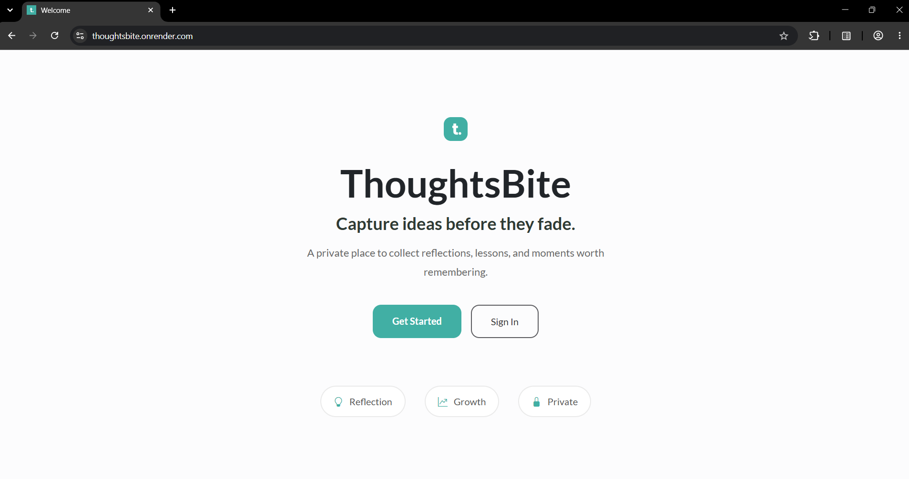
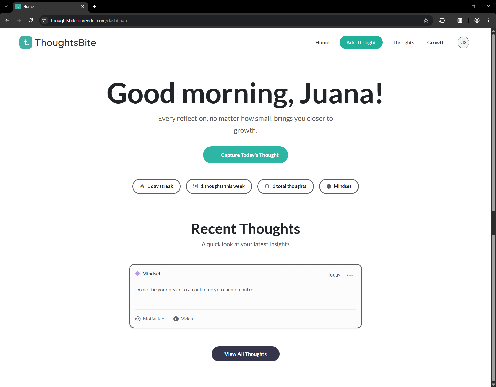
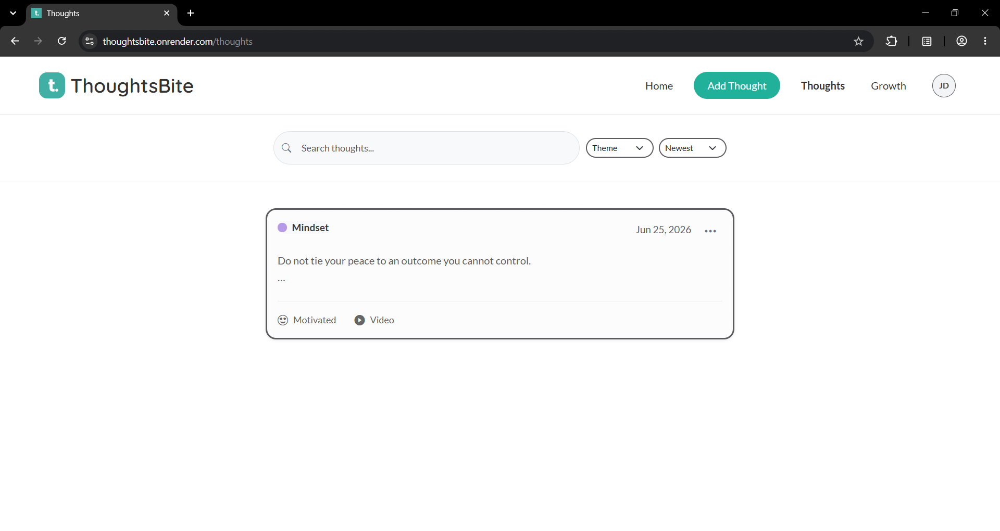
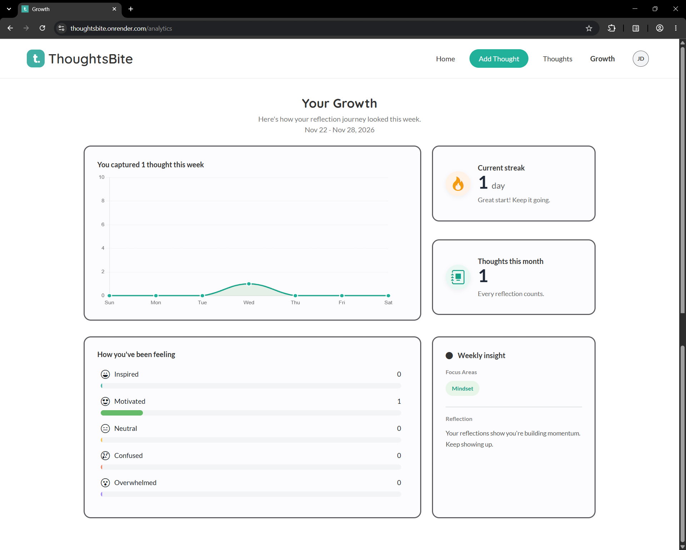

# ThoughtsBite

*A little space for thoughts, reflections, and personal growth — one thought at a time.*

## About the Project

ThoughtsBite started with a simple personal goal: **I wanted to become more disciplined and productive by making it a habit to learn and reflect on something meaningful every day.**

I used to write down my thoughts, lessons, and takeaways in the Notes app on my phone whenever I watched an inspiring video or came across something worth remembering. Eventually, I thought, why not turn that habit into something of my own?

That's how ThoughtsBite came to life.

It's a personal web application where I can capture daily reflections, organize them by theme and mood, and revisit what I've learned along the way. It also includes a growth section to help me keep track of my reflection habits and recognize patterns in my learning journey.

What started as a way to hold myself accountable became an opportunity to practice and improve my web development skills by building something useful to me.

## Live Demo

**[Visit ThoughtsBite](https://thoughtsbite.onrender.com/)**

Want to explore the application? Create an account to explore the application's features or you can use the demo account below:

Email: juanadoenut@gmail.com

Password: s4mpl3_SAMPLE

The demo account contains sample reflections so you can explore the application's features.

## Screenshots

Here are some screenshots of the application:

<!-- Replace the image paths below with your actual screenshot filenames. -->

### Welcome Page

### Overview Dashboard

### Thoughts

### Your Growth

## Features

- **User Authentication** – User registration and login with password hashing and session-based authentication.
- **Thought Management** – Create, view, update, and delete personal reflections.
- **Thought Organization** – Categorize reflections by themes and moods, with source titles and optional links.
- **Search and Filtering** – Find reflections using search, theme filters, and sorting options.
- **Growth Dashboard** – Track weekly reflection activity, current streak, and monthly reflection count.
- **Mood Tracking** – View mood trends based on weekly reflections.
- **Weekly Insights** – Get an overview of reflection activity and recurring themes.
- **User Management** – Administrative features for managing user accounts.

## Technologies Used

**Frontend**
- HTML
- CSS
- JavaScript
- Bootstrap 5
- EJS (Embedded JavaScript)

**Backend**
- Node.js
- Express.js
- MongoDB
- Mongoose

**Tools and Services**
- Git and GitHub
- MongoDB Atlas
- Render

## What I Learned

Building ThoughtsBite gave me hands-on experience with:

- Developing a full-stack web application using the MVC pattern.
- Building server-side functionality and routes with Express.js.
- Managing application data using MongoDB and Mongoose.
- Implementing user authentication, session management, and role-based access.
- Performing CRUD operations and handling form validation.
- Creating a dashboard with dynamic data and visualizations.
- Deploying a web application and connecting it to a cloud-hosted database.

## Deployment

ThoughtsBite is deployed using Render, with MongoDB Atlas as its database provider.

## Author

Developed by **Lalaine Madrona**

[GitHub Profile](https://github.com/itslalaine)
