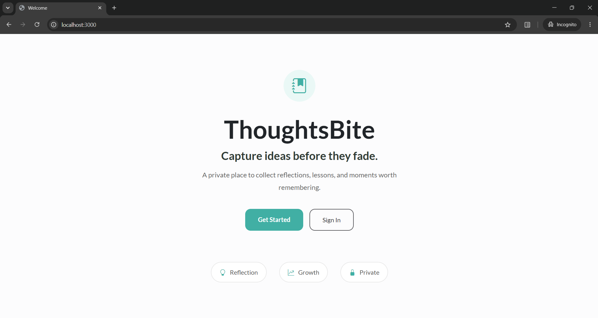
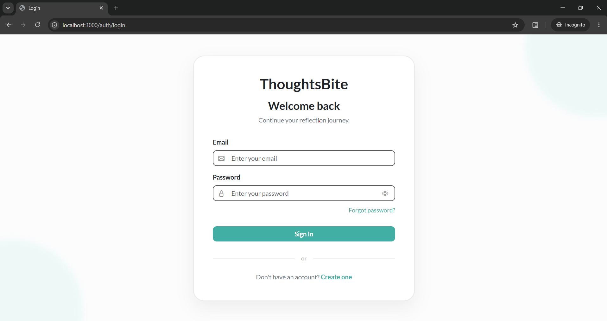
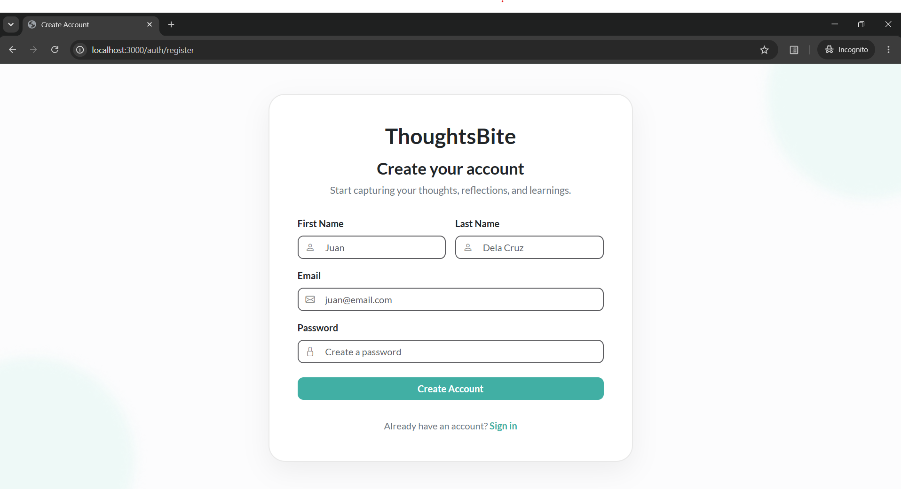
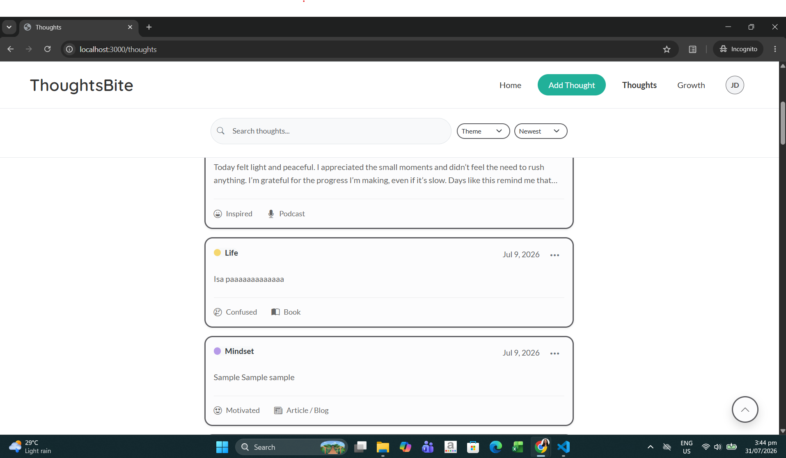
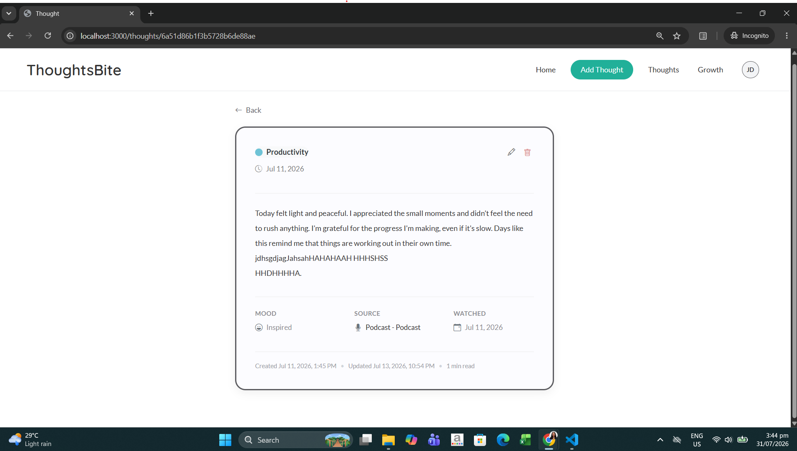
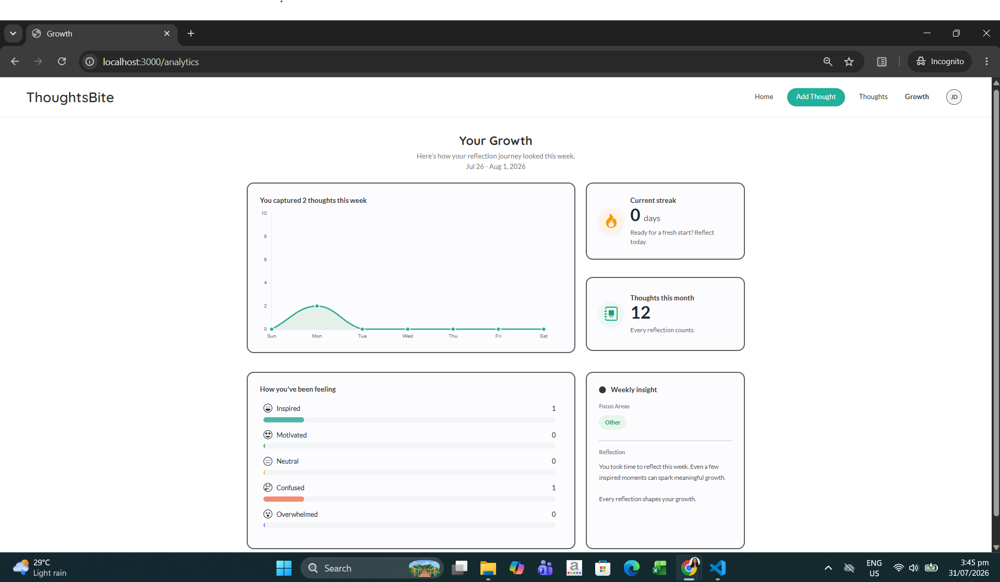
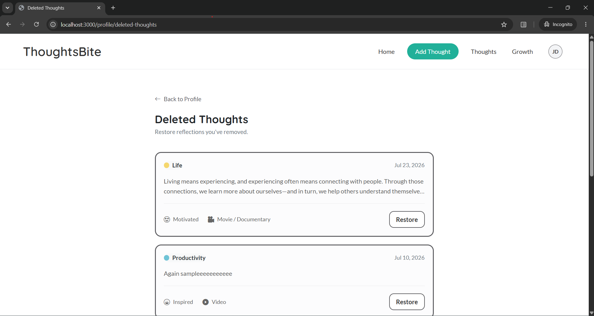
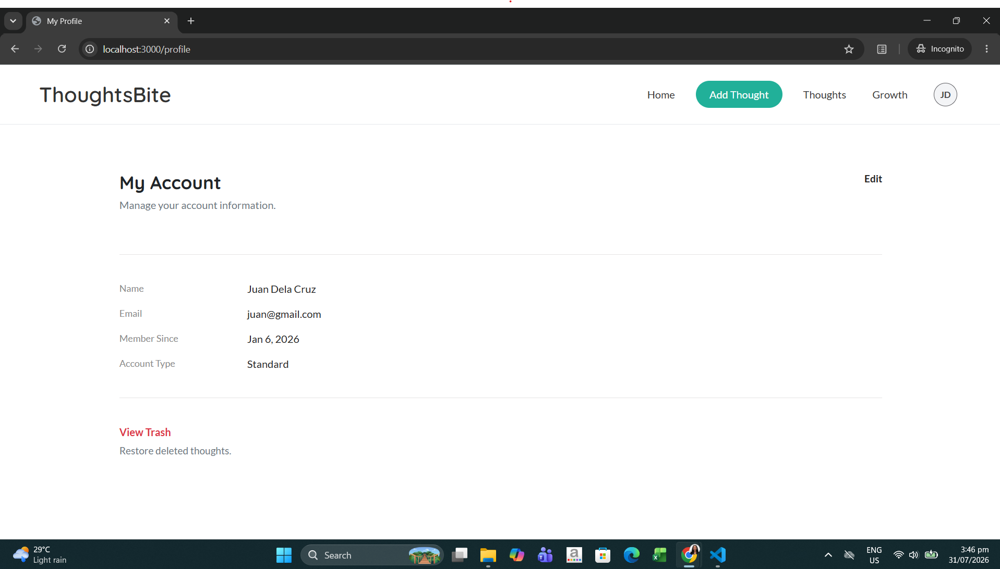

# ThoughtsBite

A personal reflection web application where users can capture ideas, organize learnings, and visualize personal growth.

## Features
- Authentication
- Add/Edit/Delete Thoughts
- Soft Delete & Restore
- Dashboard
- Analytics
- Profile Management

## Tech Stack
- Node.js
- Express.js
- MongoDB
- EJS
- Bootstrap

## Screenshots

### Landing Page

### Login Page

### Signup Page

### Home Page

### Add Thought Page

### Thoughts Page

### Thoughts Page(View Thought)

### Growth Page

### Trash Page

### Profile Page

## Live Demo

(Coming soon)